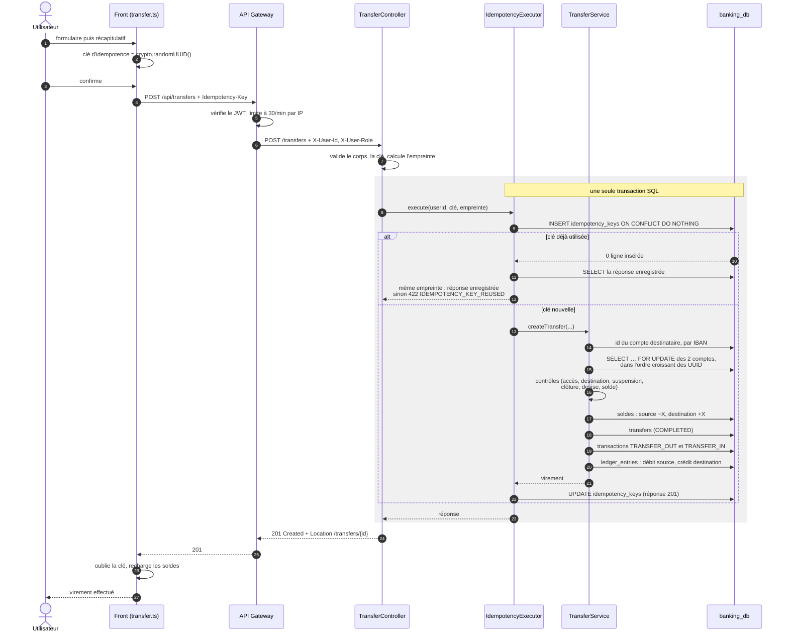
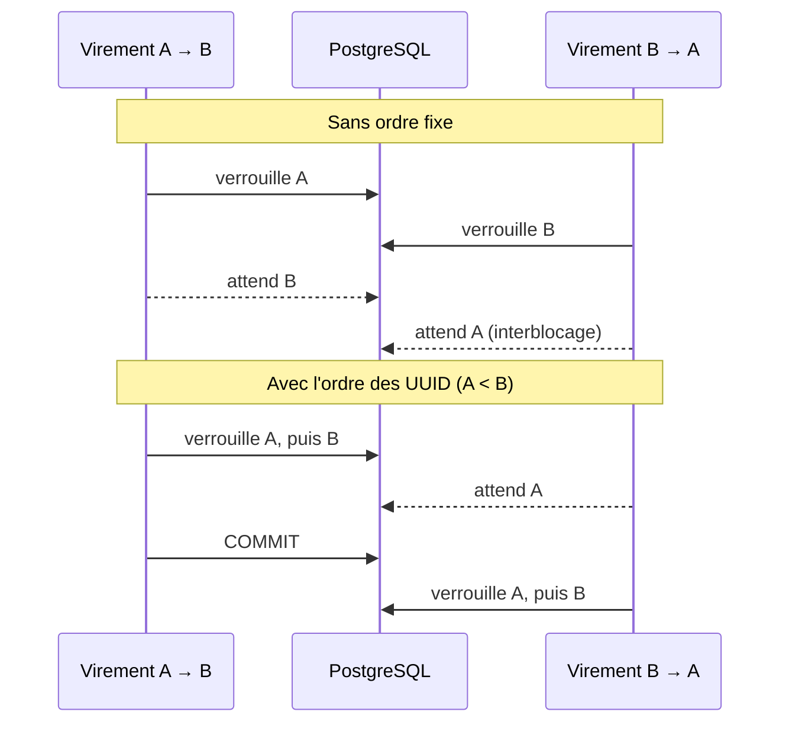

# Déroulé d'un virement

État au 2026-11-24, version `0.2.0`. Un virement est **une seule requête HTTP**, traitée par le Banking Service **dans une seule transaction PostgreSQL**. Il ne passe ni par Kafka, ni par une saga, ni par un autre service. Les règles comptables sont dans l'[ADR-006](../adr/ADR-006-comptabilite-coherence.md), le rôle de l'administrateur dans l'[ADR-005](../adr/ADR-005-role-administrateur.md) et les plafonds dans l'[ADR-007](../adr/ADR-007-garde-fous-vitrine.md).

## Diagramme de séquence

## Contrôles, dans l'ordre

Ils sont faits par `TransferService.createTransfer`, une fois les deux comptes verrouillés.

| # | Contrôle | Refus |
|---|---|---|
| 1 | Le compte source existe | 404 `ACCOUNT_NOT_FOUND` |
| 2 | La source est visible pour l'acteur : ses propres comptes pour un client, tous les comptes pour un administrateur, les clients de démo seulement pour `demo.admin` | 404 `ACCOUNT_NOT_FOUND`, pour ne pas révéler que le compte existe |
| 3 | La destination existe et n'est pas clôturée | 404 `DESTINATION_ACCOUNT_NOT_FOUND` |
| 4 | La source et la destination sont deux comptes différents | 400, erreur sur le champ `destinationIban` |
| 5 | Le client de la source n'est pas suspendu (projection `customer_refs`) | 403 `CUSTOMER_SUSPENDED` |
| 6 | La source n'est pas clôturée | 409 `ACCOUNT_CLOSED` |
| 7 | Les deux comptes ont la même devise | 409 `CURRENCY_MISMATCH` |
| 8 | Le solde suffit | 409 `INSUFFICIENT_FUNDS` |

Avant d'arriver là, `TransferRequest` a déjà vérifié le corps de la requête :
- l'IBAN est normalisé, avec 34 caractères au plus ;
- le montant est positif, avec 2 décimales au plus et 10 000,00 au maximum ;
- la description fait 140 caractères au plus.

L'en-tête `Idempotency-Key` est obligatoire : 1 à 64 caractères parmi `[A-Za-z0-9_-]`. Le compte destinataire peut appartenir à n'importe quel client.

## Idempotence

| Cas | Résultat |
|---|---|
| Clé nouvelle | Elle est réservée, le virement s'exécute et la réponse est enregistrée avec la clé |
| Même clé, même empreinte | Le virement n'est pas refait, la réponse enregistrée est renvoyée |
| Même clé, autre empreinte | 422 `IDEMPOTENCY_KEY_REUSED` |
| Deux requêtes simultanées avec la même clé | La seconde attend sur l'index unique que la première soit validée, puis renvoie sa réponse |
| Refus métier | Tout est annulé, réservation de la clé comprise, et la clé peut être réessayée |

Les clés sont propres à chaque personne : `(actor_user_id, idempotency_key)`.

Côté front, la clé est créée au récapitulatif. Elle est **gardée** après une erreur réseau ou une 5xx, pour qu'un nouvel essai ne fasse pas un deuxième virement. Elle est **oubliée** après un succès ou un refus définitif (4xx).

## Pourquoi verrouiller dans l'ordre des UUID

Sans ordre fixe, deux virements croisés peuvent se bloquer l'un l'autre (interblocage) :

## Écritures produites

Un virement de X entre deux comptes produit, dans une même transaction :

| Table | Lignes |
|---|---|
| `accounts` | Le solde de la source baisse de X, celui de la destination monte de X |
| `transfers` | 1 ligne `COMPLETED`, avec l'acteur : le client, ou l'administrateur agissant pour lui |
| `transactions` | 2 lignes : `TRANSFER_OUT` sur la source et `TRANSFER_IN` sur la destination, chacune avec le solde après l'opération |
| `ledger_entries` | 2 lignes qui s'équilibrent : un débit de X sur la source et un crédit de X sur la destination. Le compte technique `CASH` n'intervient pas |
| `idempotency_keys` | 1 ligne avec la réponse 201 |

La base refuse aussi les incohérences par elle-même, grâce aux contraintes de `V2__create_banking_schema.sql` :
- `balance >= 0` ;
- `amount > 0` ;
- `source_account_id <> destination_account_id`.

## Consultation

`GET /transfers/{id}` est permis au titulaire de la source, au titulaire de la destination et à l'administrateur. Les autres reçoivent une 404.

## Limites connues

- **Aucun événement Kafka** : `bank.transfers` reste vide.
- **Pas de saga** : un virement est `COMPLETED` dès sa création. Les statuts `PENDING` et `REJECTED` sont prévus pour une étape asynchrone, comme un contrôle de fraude.
- **Débit limité par IP seulement** : la limite par utilisateur est prévue dans BF-009-10.
