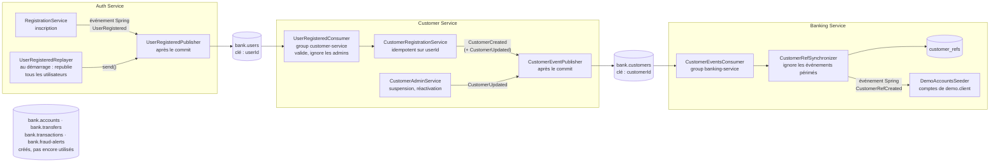
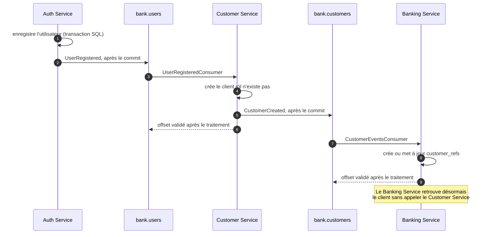

# Flux d'événements Kafka

État au 2026-11-24, version `0.2.0`. Seuls les topics `bank.users` et `bank.customers` sont utilisés. Les autres topics ([topics.md](topics.md)) existent, mais personne n'y publie encore. Le format des messages est décrit dans [contracts/events](../../contracts/events/envelope.md).

## Vue d'ensemble

## Inscription d'un client, pas à pas

## Règles qui rendent le flux sûr

| Règle | Classe ou réglage |
|---|---|
| Rien n'est publié si la transaction SQL échoue | `@TransactionalEventListener(phase = AFTER_COMMIT)` dans les deux publishers |
| Le broker ne crée pas de doublon lors d'un renvoi | `acks: all` et `enable.idempotence: true` |
| Un doublon ou un rejeu ne change rien | `CustomerRegistrationService` (idempotent sur `userId`), `CustomerRefSynchronizer` (idempotent sur `customerId`) |
| Les messages d'un même client restent dans l'ordre | La clé Kafka fixe la partition, et `occurredAt` écarte les événements périmés côté Banking |
| Un message n'est validé qu'une fois traité | `enable-auto-commit: false` |
| Un message invalide ne bloque jamais la partition | Les consumers le journalisent puis l'ignorent |
| Les logs ne contiennent jamais de données personnelles | Seuls le topic, la partition, l'offset et le type d'exception sont journalisés |

## Gestion des erreurs des consumers

| Service | Erreur passagère | Erreur de format |
|---|---|---|
| Customer Service | 2 nouvelles tentatives, 1 s d'intervalle, puis abandon | Message ignoré par le consumer |
| Banking Service | Jusqu'à 10 essais, attente doublée de 1 s à 30 s, puis abandon | Abandon immédiat (`JacksonException`, `IllegalArgumentException`, `DateTimeException`) |

Il n'y a pas encore de file de rejet (DLQ, BF-013) : un message abandonné est seulement journalisé.

## Limites connues

- **Événement perdu si Kafka est en panne au moment de l'envoi.** L'inscription réussit, mais le message n'est pas publié. `UserRegisteredReplayer` republie tous les utilisateurs au démarrage suivant de l'Auth Service. Comme `CustomerRegistrationService` republie toujours `CustomerCreated`, ce rejeu répare toute la chaîne. L'Outbox (BF-011) remplacera ce rattrapage.
- **Pas de DLQ** (BF-013).
- **Le Banking Service ne publie rien** : les virements se font en une seule transaction SQL, sans événement ni saga.
- **Notification Service et Analytics & Fraud Service** : Kafka est configuré, mais ils n'ont encore aucun consumer.
